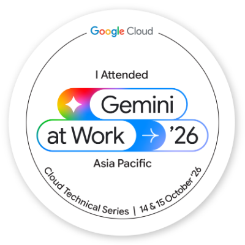

# Google-cloud-Badge-
# Google Cloud Technical Series: Gemini at Work '26

Hands-on lab implementations, badge verification, and certificate earned during the **Google Cloud Technical Series: Gemini at Work '26 (Asia Pacific)** organized by Google Cloud.

---

## 🏆 Credentials & Verification

  
  &nbsp;&nbsp;&nbsp;&nbsp;&nbsp;&nbsp;&nbsp;&nbsp;
  

  <b>Recipient:</b> Selvasridharan T  
  <b>Event:</b> Google Cloud Technical Series | 14 & 15 October, 2026

---

## 🛠️ Hands-on Labs Completed (100% Score)

- **Deploy and Query Google Gemini Enterprise:** Provisioning enterprise Gemini models, orchestrating prompts, and managing API access.
- **Add an ADK Agent to Gemini Enterprise:** Implementing Agent Development Kit (ADK) agents, configuring custom tool actions, and handling real-time workflows.

---

## 💻 Tech Stack & Skills
- **Cloud Platform:** Google Cloud Platform (GCP)
- **Generative AI:** Google Gemini Enterprise
- **Frameworks:** Agent Development Kit (ADK)
